# Stockroom WMS — Warehouse Management System for Kenyan FMCG Distributors & Logistics

[](https://openjdk.org/)
[](https://spring.io/projects/spring-boot)
[](https://www.postgresql.org/)
[](https://docs.docker.com/compose/)
[](http://localhost:8080/swagger-ui.html)

**Stockroom WMS** is an enterprise-grade Warehouse Management System engineered specifically for Kenyan Fast-Moving Consumer Goods (FMCG) distributors, wholesale cash-and-carry operators, and 3PL logistics networks operating across Nairobi and nationwide transit corridors.

Designed to operate seamlessly across high-volume Nairobi distribution centers—including **Industrial Area (Central Hub)**, **Embakasi ICD (Transit Depot)**, and **Baba Dogo (North Distribution)**—the system provides sub-second inventory visibility, bulletproof concurrency control during flash flash-order allocations, immutable stock ledger auditing, GS1-128 barcode scanning, and multi-format reporting.

---

## Table of Contents
1. [System Architecture](#system-architecture)
2. [Domain Model & Database ERD](#domain-model--database-erd)
3. [Concurrency Design & Optimistic Locking](#concurrency-design--optimistic-locking)
4. [Immutable Stock Ledger & Invariant Enforcement](#immutable-stock-ledger--invariant-enforcement)
5. [GS1-128 Barcode Format & Scanner Engine](#gs1-128-barcode-format--scanner-engine)
6. [Reports Catalog](#reports-catalog)
7. [Security & Role-Based Access Control (RBAC)](#security--role-based-access-control-rbac)
8. [Observability & Metrics](#observability--metrics)
9. [Getting Started & Local Deployment](#getting-started--local-deployment)
10. [API Reference & Postman Guide](#api-reference--postman-guide)

---

## System Architecture

Stockroom WMS adheres to a clean layered domain-driven architecture, separating presentation, application orchestration, domain business rules, and persistence infrastructure.

```
                      +---------------------------------------+
                      | Client Apps / RF Scanners / Web Portal|
                      +---------------------------------------+
                                          |
                                          | HTTPS / REST + JWT
                                          v
+---------------------------------------------------------------------------------+
|                                 STOCKROOM WMS                                   |
|                                                                                 |
|  [Security Filter Chain]  --->  [JWT Authentication & RBAC Method Security]     |
|                                                                                 |
|  [REST Controllers]                                                             |
|   * AuthController         * WarehouseController    * ProductController         |
|   * StockController        * ReservationController  * BackorderController       |
|   * ReturnController       * BarcodeController      * ReportController          |
|                                                                                 |
|  [Domain Services]                                                              |
|   * StockService           * ReservationService     * BarcodeService            |
|   * ReportService          * AuthService                                        |
|                                                                                 |
|  [Background Schedulers]                                                        |
|   * LowStockReorderScheduler (every 6h)                                         |
|   * ReservationExpiryScheduler (every 1m)                                       |
|   * StockReconciliationScheduler (nightly 02:00)                                |
|                                                                                 |
|  [Persistence & Engines]                                                        |
|   * Spring Data JPA / Hibernate (with @Version Optimistic Locking)              |
|   * JasperReports 6 (JasperCompileManager + PDF Exporter)                       |
|   * Apache POI 5 (SXSSF Streaming Excel + FIFO Valuation)                       |
|   * ZXing (GS1-128 / Code 128 Matrix Barcode Generator)                         |
|   * Micrometer Prometheus Meter Registry                                        |
+---------------------------------------------------------------------------------+
          |                    |                  |                 |
          v                    v                  v                 v
   +--------------+    +---------------+    +------------+    +------------+
   |  PostgreSQL  |    |  Redis Cache  |    |   MinIO    |    | Prometheus |
   |  15 Cluster  |    |  Job Queue    |    | S3 Storage |    | & Grafana  |
   +--------------+    +---------------+    +------------+    +------------+
```

---

## Domain Model & Database ERD

The entity-relationship model is implemented through Flyway migrations with strict foreign key constraints, unique indexes, and version timestamp auditing.

```mermaid
erDiagram
    WAREHOUSES ||--o{ LOCATIONS : contains
    WAREHOUSES ||--o{ REORDER_ALERTS : generates
    LOCATIONS ||--o{ STOCK_ITEMS : stores
    LOCATIONS ||--o{ STOCK_MOVEMENTS : logs
    LOCATIONS ||--o{ RESERVATIONS : holds
    PRODUCTS ||--o{ STOCK_ITEMS : tracks
    PRODUCTS ||--o{ STOCK_MOVEMENTS : logs
    PRODUCTS ||--o{ RESERVATIONS : allocated_for
    PRODUCTS ||--o{ BACKORDERS : ordered_against
    PRODUCTS ||--o{ STOCK_RETURNS : returned_against
    PRODUCTS ||--o{ REORDER_ALERTS : monitors
    USERS ||--o{ STOCK_MOVEMENTS : performs

    WAREHOUSES {
        uuid id PK
        varchar code UK "e.g., NBO-01"
        varchar name
        varchar county "e.g., Nairobi"
        varchar town "e.g., Industrial Area"
        varchar address
        uuid manager_id
        boolean active
    }

    LOCATIONS {
        uuid id PK
        uuid warehouse_id FK
        varchar code "e.g., A-01-03"
        varchar zone "RECEIVING|STORAGE|PICKING|SHIPPING|RETURNS"
        int capacity_units
    }

    PRODUCTS {
        uuid id PK
        varchar sku UK "e.g., KEP-PEM-2KG"
        varchar name "e.g., Pembe Maize Meal 2kg"
        text description
        varchar category "e.g., Dry Goods"
        varchar unit_of_measure "e.g., BALE"
        varchar barcode UK "GTIN-14 / EAN-13"
        int reorder_point
        int reorder_qty
        numeric unit_cost "KES"
        numeric unit_price "KES"
    }

    STOCK_ITEMS {
        uuid id PK
        uuid product_id FK
        uuid location_id FK
        int quantity_on_hand
        int quantity_reserved
        varchar batch_number
        date expiry_date
        bigint version "Optimistic Lock"
    }

    STOCK_MOVEMENTS {
        uuid id PK
        uuid product_id FK
        uuid location_id FK
        varchar type "RECEIPT|ISSUE|TRANSFER|RESERVATION|RELEASE|ADJUSTMENT|RETURN"
        int quantity "Signed Ledger Entry"
        varchar reference_type
        varchar reference_id
        uuid user_id FK
        timestamp created_at
        text notes
    }

    RESERVATIONS {
        uuid id PK
        varchar order_id
        uuid product_id FK
        uuid location_id FK
        int quantity
        varchar status "ACTIVE|FULFILLED|RELEASED|EXPIRED"
        timestamp expires_at
        timestamp created_at
    }

    BACKORDERS {
        uuid id PK
        varchar order_id
        uuid product_id FK
        int quantity_ordered
        int quantity_fulfilled
        int quantity_pending
        varchar status "PENDING|PARTIALLY_FULFILLED|FULFILLED|CANCELLED"
    }

    STOCK_RETURNS {
        uuid id PK
        varchar original_order_id
        uuid product_id FK
        int quantity
        varchar reason "DAMAGED|WRONG_ITEM|EXPIRED|CUSTOMER_RETURN"
        varchar status "PENDING|INSPECTED|RESTOCKED|SCRAPPED"
        text inspection_notes
    }

    REORDER_ALERTS {
        uuid id PK
        uuid product_id FK
        uuid warehouse_id FK
        int current_qty
        int reorder_point
        int suggested_qty
        varchar status "OPEN|ACKNOWLEDGED|ORDERED|DISMISSED"
        timestamp created_at
    }

    USERS {
        uuid id PK
        varchar username UK
        varchar password_hash
        varchar full_name
        varchar role "ADMIN|WAREHOUSE_MANAGER|PICKER|AUDITOR"
        boolean active
    }
```



---

## Concurrency Design & Optimistic Locking

In fast-paced FMCG distribution, checkout surges from e-commerce portals, major supermarket buyers (e.g., Naivas, Carrefour, QuickMart), and roadside dukas compete for limited stock simultaneously.

### The Problem
Traditional dirty reads or coarse-grained table locks cause severe throughput bottlenecks or overselling.

### The Stockroom WMS Solution
1. **Optimistic Locking (`@Version`):**
   - Each `StockItem` carries a `version` column.
   - When a reservation is requested:
     ```
     Available = quantityOnHand - quantityReserved
     if (Available < requestedQuantity) throw InsufficientStockException
     quantityReserved += requestedQuantity
     save(stockItem)
     ```
2. **Exponential Backoff Retry Strategy:**
   - On `OptimisticLockException` / `ObjectOptimisticLockingFailureException`, the system catches the conflict.
   - It performs up to **5 automated retries** with jittered backoff (30ms–150ms), re-reading the freshest version from PostgreSQL.
3. **Verified Zero Oversell Under 100 Concurrent Threads:**
   - Validated by [`ReservationConcurrencyTest`](file:///c:/Users/crnji/Videos/Projects/Java/stockroom-wms/src/test/java/com/stockroom/wms/ReservationConcurrencyTest.java):
   - When 100 concurrent worker threads attempt to reserve 1 unit each from a batch with only 10 units available:
     - **Exactly 10 succeed**.
     - **90 fail with clean HTTP 400 Insufficient Stock**.
     - `quantityReserved` reaches exactly 10.
     - `quantityAvailable` reaches exactly 0.
     - Zero deadlocks or race conditions.

---

## Immutable Stock Ledger & Invariant Enforcement

Stockroom WMS enforces double-entry-style accounting invariants on physical stock:

### The Ledger Invariant
$$\text{quantityOnHand}_{(P, L)} \equiv \sum_{m \in \text{Movements}_{(P, L)}} m.\text{quantity}$$

- Every stock modification—`RECEIPT`, `ISSUE`, `TRANSFER`, `ADJUSTMENT`, `RETURN`—must append a permanent, immutable record to `stock_movements`.
- Direct modification of `quantityOnHand` without an accompanying movement is prohibited.
- Transfers across warehouses generate two complementary entries (`ISSUE` at source and `RECEIPT` at destination) tied together by a shared `transferId`.

### Nightly & On-Demand Automated Reconciliation
- **Nightly Cron (`0 0 2 * * *`):** [`StockReconciliationScheduler`](file:///c:/Users/crnji/Videos/Projects/Java/stockroom-wms/src/main/java/com/stockroom/wms/scheduler/StockReconciliationScheduler.java) scans all active product locations.
- **On-Demand Validation:** Call `stockService.reconcileStockItem(itemId)` or query `/stock/movements`.
- Any mismatch raises an urgent metric alert (`stock_reconciliation_discrepancies`) and triggers an audit exception.

---

## GS1-128 Barcode Format & Scanner Engine

The scanner module complies with GS1 General Specifications for supply-chain tracking.

### Application Identifiers (AIs) Supported

| AI | Data Field | Length | Format / Description | Example |
| :---: | :--- | :---: | :--- | :--- |
| **01** | Global Trade Item Number (GTIN) | 14 digits | Fixed; includes packaging indicator & Modulo-10 check digit | `06161101234566` |
| **10** | Batch / Lot Number | 1–20 chars | Variable alphanumeric | `BAT-2026-NBO-01` |
| **17** | Expiration Date | 6 digits | `YYMMDD` format | `261231` (31 Dec 2026) |
| **21** | Serial Number | 1–20 chars | Variable alphanumeric unit identifier | `SER-883921` |

### GS1 Modulo-10 Check Digit Calculation
For GTIN-14, positions 1 through 13 alternate multipliers 3 and 1, starting from position 13 (right-to-left before check digit):

$$\text{Weighted Sum} = \sum_{i=1}^{13} d_i \times w_i \quad \text{where } w = [3, 1, 3, 1, 3, 1, 3, 1, 3, 1, 3, 1, 3]$$

$$\text{Check Digit} = (10 - (\text{Weighted Sum} \pmod{10})) \pmod{10}$$

### Scanner API Usage
- **Scan Inbound / Outbound:**
  `POST /barcode/scan`
  ```json
  {
    "barcode": "(01)06161101234566(10)BAT-2026-NBO-01(17)261231(21)SN-99812",
    "action": "IN",
    "locationId": "a1b2c3d4-0000-0000-0000-000000000001",
    "quantity": 50,
    "reference": "GRN-2026-882"
  }
  ```
- **Generate GS1-128 Barcode Image (ZXing):**
  `GET /barcode/generate/{productId}?batchNumber=BAT-01&expiryDate=2026-12-31`
  Returns an `image/png` Code-128 barcode ready for industrial thermal label printers (Zebra, Honeywell, TSC).

---

## Reports Catalog

Stockroom WMS delivers production-grade enterprise reports in both PDF (via JasperReports 6) and Excel (via Apache POI 5).

| Report Name | Format | Engine | Key Features | Sample File |
| :--- | :---: | :---: | :--- | :--- |
| **Depot Inventory Snapshot** | PDF | JasperReports | Styled header band, alternating row colors, location grouping, total quantities | [`inventory_report.pdf`](file:///c:/Users/crnji/Videos/Projects/Java/stockroom-wms/samples/inventory_report.pdf) |
| **Depot Inventory Workbook** | XLSX | Apache POI | Navy headers, auto-filters, zebra striping, currency formatting, `SUM` formulas | [`inventory_report.xlsx`](file:///c:/Users/crnji/Videos/Projects/Java/stockroom-wms/samples/inventory_report.xlsx) |
| **Low-Stock Critical Reorder** | PDF | JasperReports | Red alert badge, reorder point thresholds, suggested reorder quantities | [`low_stock_report.pdf`](file:///c:/Users/crnji/Videos/Projects/Java/stockroom-wms/samples/low_stock_report.pdf) |
| **Stock Movement Ledger** | XLSX | Apache POI | Filterable by date range, signed quantities, movement types, user audit trails | [`movements_report.xlsx`](file:///c:/Users/crnji/Videos/Projects/Java/stockroom-wms/samples/movements_report.xlsx) |
| **Inventory FIFO Valuation** | XLSX | Apache POI | Batch aging, unit costs, extended inventory values, total balance sheet formulas | [`valuation_report.xlsx`](file:///c:/Users/crnji/Videos/Projects/Java/stockroom-wms/samples/valuation_report.xlsx) |

### Asynchronous Report Generation Queue
Large export jobs (e.g., 100,000+ movement records) run asynchronously without blocking web workers:
1. Client requests `GET /reports/inventory.pdf?warehouseId={id}&async=true`.
2. Server immediately returns `202 Accepted` with a `jobId`:
   ```json
   {
     "jobId": "e5b8d287-c5aa-43d5-9988-8e65874c7210",
     "status": "PROCESSING",
     "pollUrl": "/reports/jobs/e5b8d287-c5aa-43d5-9988-8e65874c7210"
   }
   ```
3. Client polls `/reports/jobs/{jobId}` until `status: "COMPLETED"`.
4. Client downloads via `GET /reports/download/{jobId}`.

---

## Security & Role-Based Access Control (RBAC)

The system enforces granular method-level authorization with Spring Security `@PreAuthorize`:

| Role | Permissions & Permitted Operations |
| :--- | :--- |
| **`ADMIN`** | Create/deactivate warehouses, manage user credentials, full system override. |
| **`WAREHOUSE_MANAGER`** | Receive stock, approve cycle count adjustments, manage locations, trigger returns restock/scrap. |
| **`PICKER`** | Execute reservations, issue stock against pick-lists, scan barcodes IN/OUT, create returns. |
| **`AUDITOR`** | Read-only access to products, warehouses, stock movements, and financial/valuation reports. |

### Pre-Seeded Demonstration Users
Password for all demo accounts: `Password123!`

- `admin` (`ROLE_ADMIN`)
- `manager` (`ROLE_WAREHOUSE_MANAGER`)
- `picker` (`ROLE_PICKER`)
- `auditor` (`ROLE_AUDITOR`)

---

## Observability & Metrics

Stockroom WMS exposes production metrics scraped by Prometheus and rendered in pre-configured Grafana dashboards.

### Custom Business Metrics
- `stock_movements_total{type="RECEIPT|ISSUE|..."}`: Counter of all ledger movements.
- `stock_reservation_failures_total`: Tracks failed reservations due to stock exhaustion.
- `stock_report_duration_seconds`: Histogram & summary timer for report generation latencies.
- `stock_reorder_alerts_active`: Gauge of currently open reorder alerts requiring buyer attention.

### Dashboards & Actuator Endpoints
- **Actuator Health:** `GET http://localhost:8080/actuator/health`
- **Prometheus Scrape:** `GET http://localhost:8080/actuator/prometheus`
- **Grafana Dashboard:** `http://localhost:3000` (User: `admin`, Pass: `admin`)
  - Auto-provisioned datasource: `docker/grafana/provisioning/datasources/datasource.yml`
  - Dashboard definition: `docker/grafana/dashboards/stockroom-wms.json`

---

## Getting Started & Local Deployment

### Prerequisites
- Java 17 or Java 21 LTS
- Docker & Docker Compose
- Maven 3.8+ (or use the included `./mvnw.cmd` / `./mvnw`)

### Option A: Complete Docker Compose Stack
Launch all services (Application, PostgreSQL 15, Redis 7, MinIO S3, Prometheus, Grafana) with a single command:

```powershell
docker compose up -d --build
```

Access the services:
- **Stockroom WMS API:** `http://localhost:8080`
- **Swagger OpenAPI Documentation:** `http://localhost:8080/swagger-ui.html`
- **Grafana Observability:** `http://localhost:3000`
- **MinIO S3 Console:** `http://localhost:9001` (User: `minioadmin`, Pass: `minioadmin`)
- **Prometheus Console:** `http://localhost:9090`

### Option B: Local Development Execution
1. Start infrastructure dependencies:
   ```powershell
   docker compose up -d postgres redis minio prometheus grafana
   ```
2. Run database migrations and start the application:
   ```powershell
   .\mvnw.cmd spring-boot:run
   ```
3. Run the complete test suite:
   ```powershell
   .\mvnw.cmd test
   ```

---

## API Reference & Postman Guide

A complete, ready-to-run Postman collection is located in [`postman/Stockroom_WMS.postman_collection.json`](file:///c:/Users/crnji/Videos/Projects/Java/stockroom-wms/postman/Stockroom_WMS.postman_collection.json).

### Quick Authentication
Send a login request to populate the `{{token}}` variable automatically:
- **POST** `/auth/login`
  ```json
  {
    "username": "manager",
    "password": "Password123!"
  }
  ```

### Key API Endpoints Summary

#### Warehouses & Locations
- `POST /warehouses`: Register a new Nairobi depot
- `GET /warehouses`: List all depots with manager contacts
- `POST /warehouses/{id}/locations`: Define bin/aisle locations with zone assignments

#### Products & Catalog
- `POST /products`: Register FMCG products with GS1 GTIN barcodes
- `GET /products`: Paginated product directory with category filters
- `GET /products/{id}/stock?warehouseId=`: Aggregate stock across bins and depots

#### Stock Operations
- `POST /stock/receive`: Inbound Goods Receipt Note (GRN) posting with batch and expiry
- `POST /stock/issue`: Outbound dispatch of picked goods
- `POST /stock/transfer`: Inter-depot stock transfers linked by `transferId`
- `POST /stock/adjust`: Cycle-count stock adjustment with required reason
- `GET /stock/movements`: Query immutable audit ledger with date and location filters

#### Reservations & Backorders
- `POST /reservations`: Allocate stock with TTL minutes (optimistic lock protected)
- `POST /reservations/{id}/fulfill`: Confirm dispatch of reserved stock
- `POST /reservations/{id}/release`: Manual release of reserved units
- `GET /backorders`: Review pending unfulfilled customer orders
- `POST /backorders/{id}/fulfill`: Allocate incoming stock to pending backorders

#### Returns
- `POST /returns`: Log customer or transit return with damage reason
- `POST /returns/{id}/inspect`: Record QA inspector verdict
- `POST /returns/{id}/restock`: Return inspected undamaged units back to inventory
- `POST /returns/{id}/scrap`: Write off damaged or expired stock

#### Barcodes & Reports
- `POST /barcode/scan`: High-speed GS1-128 scanner webhook
- `GET /barcode/generate/{productId}`: Generate high-resolution Code-128 barcode image
- `GET /reports/inventory.pdf`: Export JasperReports inventory snapshot
- `GET /reports/inventory.xlsx`: Export Apache POI formatted inventory spreadsheet
- `GET /reports/valuation.xlsx`: Export FIFO inventory financial valuation

---

## License
Proprietary — Built for Kenyan FMCG Distributors and Logistics Operators.
